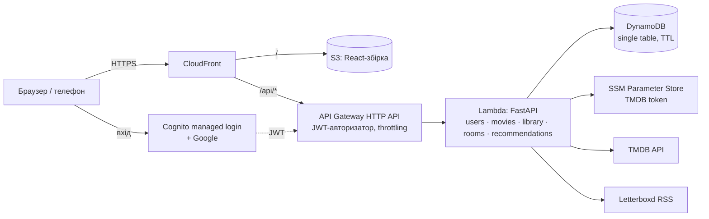

# 🎬 Movie Night

**Обрати фільм на компанію — за три хвилини. Без суперечок.**

Movie Night — вебзастосунок для компанії друзів, яка годину гортає каталоги й не може домовитись, що дивитись.
Хтось створює кімнату, решта заходить за кодом або QR. Кожен свайпає підбірку, складену під смаки **всіх**
учасників (і без фільмів, які хтось уже бачив). Щойно фільм сподобався всім — «ЗБІГ!», конфеті, сеанс.
Якщо ідеального збігу немає, показуємо фільми, які сподобались хоча б комусь.

**Демо:** https://movienight-ucu.pages.dev (те саме напряму з AWS: https://d2nvw32wp3gy8d.cloudfront.net)

## Що вміє

| | |
|---|---|
| **Вхід** | Реєстрація поштою або через Google (Amazon Cognito) |
| **Фільмотека** | Пошук фільмів (TMDB, українською), оцінки ★, перемикач «готовий передивитись» біля кожного фільму |
| **Letterboxd** | Імпорт за нікнеймом (публічний RSS, ~50 останніх) або повний — з файлу експорту `.zip/.csv` |
| **Кімнати** | Код + QR + «Поділитись». Кожен учасник сам обирає настрій: до 3 жанрів, тривалість, епоху. Лобі показує, що виходить разом |
| **Рекомендації** | Колода з 20 фільмів: спершу ті, що поєднують жанри всіх учасників, далі схожі на їхні улюблені фільми, з хорошим рейтингом; кожна картка пояснює, *чому* її запропоновано |
| **Свайпи** | Вправо/вліво з фізикою, тап — деталі (опис, режисер, актори), стрілки на клавіатурі |
| **Маскоти** | 6 власних анімованих персонажів; сидять у «залі», стежать очима за курсором і реагують на голоси учасників |
| **Результат** | «ЗБІГ!» в реальному часі, афіша з рейтингом лайків, «ще 20 фільмів», фінальний екран «Сьогодні дивимось» |
| **Друзі** | Автоматично — усі, з ким ти був в одній кімнаті. Можна кликати друзів у свій зал і заходити до них без коду, якщо вони зараз у кімнаті |

## Архітектура

Модульний моноліт на serverless AWS: одна Lambda з чітко розділеними модулями, без VPC.



Детальніше — [docs/architecture.md](docs/architecture.md): нефункціональні вимоги з числами, рішення та їх обґрунтування, модель даних.

Ключові рішення коротко:

- **Модульний моноліт, а не мікросервіси.** Команда маленька, домен ще змінюється. Межі модулів перевіряє `import-linter` (`backend/.importlinter`).
- **Lambda + DynamoDB, а не ECS + RDS.** Бюджет майже нульовий. Lambda з RDS мусила б жити у VPC, а виходити звідти до TMDB довелося б через NAT Gateway (~$32/міс). DynamoDB on-demand коштує $0, коли застосунком ніхто не користується.
- **Автентифікацію купуємо, а не пишемо.** Підпис токена перевіряє API Gateway ще до запуску Lambda. Lambda лише читає claims і перевіряє права: хто ведучий, хто учасник кімнати.
- **Опитування сервера раз на 2 с замість WebSocket.** Для кімнат на 2–12 людей цього досить, і так значно простіше.
- **Читабельна адреса безкоштовно.** `movienight-ucu.pages.dev` — це 8-рядковий проксі на Cloudflare Pages (`infra/pages-proxy/`), який пересилає кожен запит у наш CloudFront. Сайт, API й дані лишаються на AWS. Якщо з'явиться власний домен — `DOMAIN_NAME` у `.env`, і Terraform налаштує сертифікат, CloudFront і DNS (`infra/domain.tf`).
- **Уся інфраструктура описана в Terraform** (`infra/`), стан лежить у віддаленому S3 з блокуванням.

## Структура репозиторію

```
backend/    FastAPI-застосунок для Lambda (Python 3.13)
  app/
    shared/            auth (claims з JWT), db (DynamoDB), config, доменні помилки
    users/             профіль, маскоти, друзі
    movies/            адаптер TMDB (єдине місце, що знає про TMDB)
    library/           фільмотека, імпорт Letterboxd (RSS + CSV)
    recommendations/   scoring.py — чиста логіка підбору; service.py — збирає кандидатів з TMDB
    rooms/             кімнати, голоси, збіги (logic.py — чисті правила)
  tests/               pytest
  .importlinter        контракти меж модулів і шарів
frontend/   React + TypeScript + Vite + Framer Motion
  src/components/      маскоти (SVG), колода свайпів, квиток з QR, атмосфера (завіса, зерно, промінь)
  src/pages/           лендінг, зал, фільмотека, друзі, профіль, кімната
infra/      Terraform: Cognito, DynamoDB, Lambda, API Gateway, S3, CloudFront, SSM, Budget
scripts/    deploy.sh — повний деплой; deploy-frontend.sh — лише фронтенд; deploy-pages-proxy.sh — адреса *.pages.dev; e2e.py — наскрізна перевірка
docs/       архітектура
```

## Запуск локально

Потрібно: Node 20+, Python 3.12+.

**Фронтенд** (ходить у задеплоєний бекенд через proxy, див. `frontend/vite.config.ts`):

```bash
cd frontend
npm ci
npm run dev          # http://localhost:5173
```

**Бекенд — тести і перевірка меж модулів:**

```bash
cd backend
python3 -m venv .venv && .venv/bin/pip install -r requirements-dev.txt
.venv/bin/pytest            # юніт-тести рекомендацій і правил кімнати
.venv/bin/lint-imports      # модулі спілкуються лише через api.py; router → service → repository
```

**Бекенд локально** (з реальною DynamoDB у вашому акаунті, без Cognito):

```bash
cd backend
TABLE_NAME=movie-night TMDB_TOKEN=... DEV_AUTH=1 .venv/bin/uvicorn app.main:app --reload
curl -H "X-Dev-User: alice" localhost:8000/api/me
```

## Деплой з нуля

Потрібно: AWS CLI (з активним логіном), Terraform ≥ 1.10, Node 20+, Python 3.12+.

1. **Секрети.** `cp .env.example .env` і заповни. Обов'язковий лише `TMDB_TOKEN`: це API Read Access Token з [themoviedb.org → Settings → API](https://www.themoviedb.org/settings/api).
2. **Бакет для стану Terraform** (один раз на акаунт):
   ```bash
   infra/bootstrap.sh       # створює приватний версіонований бакет; назву впиши в infra/versions.tf
   ```
3. **Деплой:**
   ```bash
   scripts/deploy.sh        # build бекенду → terraform plan (покаже зміни, спитає) → apply → build і заливка фронтенду
   ```
   Наприкінці скрипт виведе адресу застосунку.
4. **Google-вхід (необов'язково):**
   - у [Google Cloud Console](https://console.cloud.google.com) створи OAuth-клієнт типу *Web application*;
   - як redirect URI вкажи значення з `terraform -chdir=infra output google_redirect_uri`;
   - додай `amazoncognito.com` в *Authorized domains* і переведи застосунок в *In production*;
   - заповни `GOOGLE_CLIENT_ID`/`GOOGLE_CLIENT_SECRET` у `.env` і знову запусти `scripts/deploy.sh`.

Наскрізна перевірка задеплоєного стеку: `backend/.venv/bin/python scripts/e2e.py`. Скрипт створює двох тестових користувачів `e2e-*@example.com` і проходить увесь сценарій: бібліотека → імпорт → кімната → голоси → збіг → вибір фільму.

## Вартість

На масштабі прототипу майже все вкладається в безкоштовні ліміти AWS: Lambda, DynamoDB on-demand, CloudFront, Cognito до 10 000 MAU. Очікуваний рахунок — **$0–2 на місяць**. AWS Budget надсилає лист, якщо витрати перевищать $5 (50 % від $10) або прогноз — $10. API Gateway обмежує навантаження до 50 запитів/с, тож помилка в клієнті не перетвориться на рахунок.

## Подяки

Дані про фільми — [TMDB](https://www.themoviedb.org). *This product uses the TMDB API but is not endorsed or certified by TMDB.*
Імпорт переглядів — з публічного RSS і функції експорту [Letterboxd](https://letterboxd.com). Маскоти намальовані для цього проєкту.

Навчальний проєкт курсу «Об'єктно-орієнтований аналіз і дизайн», УКУ, 2026.
